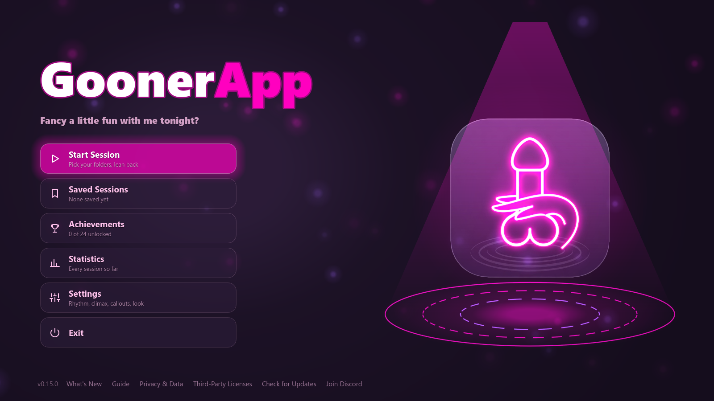
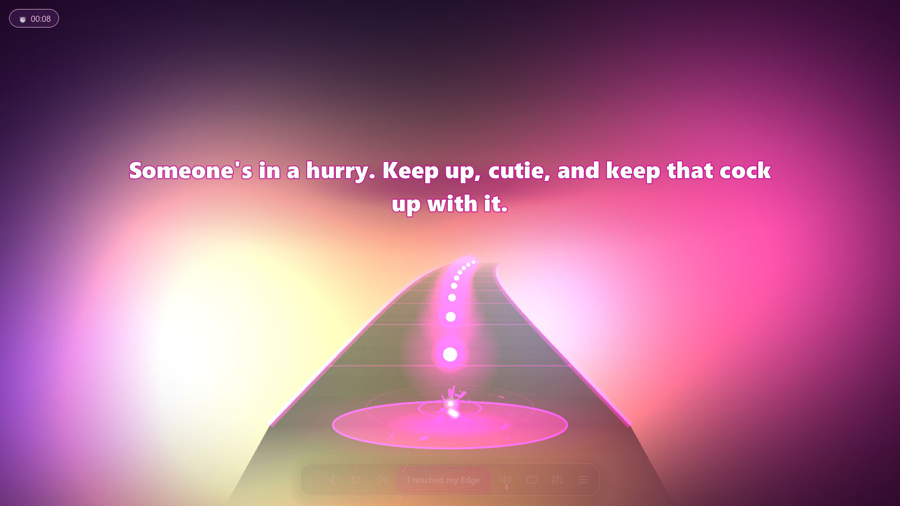
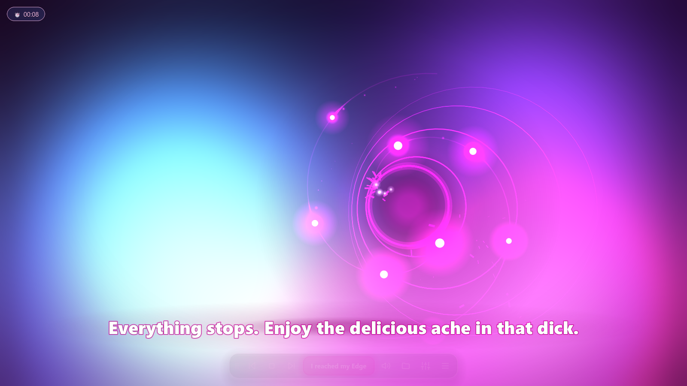
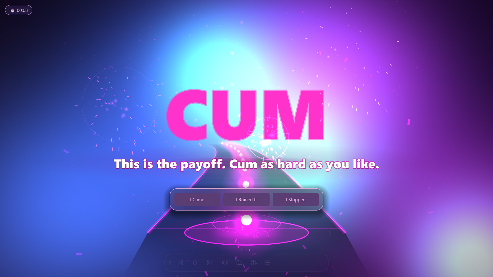
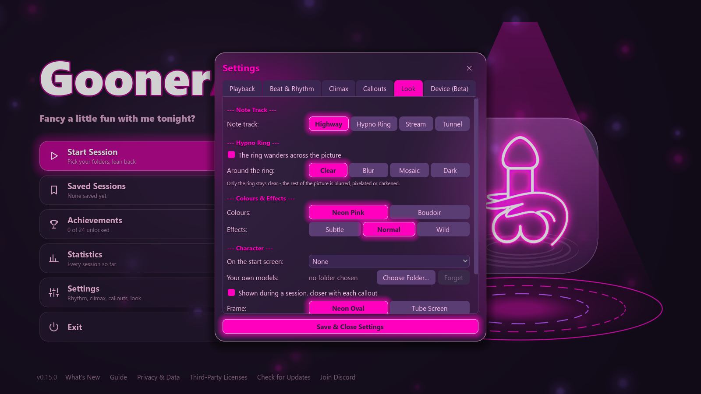
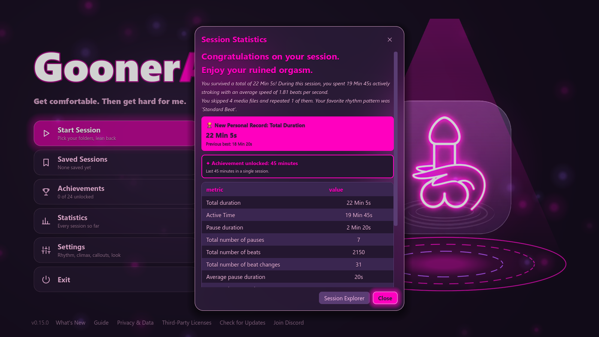

# Auto Hero Generation (GoonerApp)

A specialized, interactive multimedia application, built on the Godot engine, designed to transform your local media library (images, GIFs, and videos) into a dynamic, personalized "Cock Hero" session. The app combines a randomized playlist with a configurable, interactive rhythm generator ("Strokemeter"), motivational text instructions (callouts) - and a 3D character, Zazurona or one of your own, who watches you, talks to you and strokes along with the beat.

**100% local and private.** Your media, session history, and settings never leave your machine — no account, no login, no telemetry, no cloud calls of any kind. There are exactly two opt-in exceptions, both off until you ask for them: **Check for Updates** pings GitHub.com when you explicitly click it, and optional device output (Settings > Device) connects to an Intiface server whose address you type in yourself. That second one ships disabled, switches itself off again at every launch, and asks before it connects — see below.

Local still means written somewhere, so: your data (session history, custom patterns, custom phrase files, remembered media folders, saved sessions) lives as plain JSON in `%LOCALAPPDATA%\GoonerCock\GoonerApp`, and your settings right beside it in `settings.json`. The one other thing written is the graphics engine's shader cache in `%APPDATA%\Godot\app_userdata\GoonerApp`, which keeps the start and the first seconds of a session from stuttering and holds nothing about you or your media. GoonerApp is portable, so deleting its folder leaves your data behind — **Privacy & Data** (on the start screen) shows the exact paths, opens the data folder, and deletes any of it per category, the shader cache included.

One thing there is worth naming: a session you explicitly **save** records the paths of the media it showed, so it can find them again when you replay it. That is the only thing the app writes to disk that contains them, it only happens when you press Save, and it is deletable like everything else. Exporting a session to hand on asks every time whether to include those paths.

## ✨ Features

* **Playlist Functionality:** Select any local folder. The application recursively searches for all supported media formats (`.mp4`, `.avi`, `.mov`, `.mkv`, `.gif`, `.jpeg`, `.jpg`, `.png`, `.bmp`) and shuffles them. Videos encoded as HEVC (H.265) are not supported yet and are skipped.
* **Interactive Strokemeter:** A rhythm generator with automatically varying beat frequencies and rhythm patterns (e.g., *Standard Beat*, *Quick Swing*, *Simple Bounce*, *Double Tap*), a click on every beat, and optional difficulty ramping that gradually intensifies the session as it goes on.
* **Four Note Tracks:** Watch every beat coming before you hear it — notes land in the hit zone exactly on the click. Pick a **Highway** running into the picture, a **Hypno Ring** that can wander across the screen and drag your eyes along (blurring, pixelating or darkening everything outside it, if you like), the classic **Stream**, or a **Tunnel** to fall into.
* **A Look That Hits Back:** Neon Pink or Boudoir colours, effects from subtle to wild, and a climax that takes over the whole screen — flash, shake, colours tearing apart. A fake-out runs exactly the same effects, right up until it is revealed.
* **Characters:** Zazurona comes with the app; bring your own `.vrm` model for anyone else. She waits for you on the start screen, watches you from a frame during the session, comes closer with every callout, says her lines in a speech bubble, and strokes in time with your beat. [How to add one](#-characters-your-own-vrm-models).
* **Custom Beat Patterns:** Build your own rhythm patterns in the built-in Pattern Editor and mix them in alongside the presets.
* **Optional Device Output (Beta):** Drive a linear stroker through Intiface Central in time with the Strokemeter, using predictive position-and-duration commands — with a configurable stroke range, test movements and an emergency stop. Off by default and off again at every launch.
* **Random Pause Phases:** The Strokemeter unexpectedly takes a controlled break — and the notes behind it fly in while it lasts, so you can see the beat coming back.
* **Climax System:** Configurable climax announcements with real, ruined, and denied orgasm outcomes, plus optional fake climax cues to keep you guessing — chances for every outcome are independently tunable.
* **Edge Relief On Demand:** About to lose it? Hit `E`. The Strokemeter pauses and comes back at the bottom of its current speed range, and the climax waits out the break instead of being paid for with it — you edged, so you wait longer. Cooldown included, because otherwise holding the key down would turn the session into a nap.
* **Tell It What You Actually Did:** Every climax cue offers **I Came / I Ruined It / I Stopped** — because the app only knows what it *told* you to do, and being denied and obeying is not the same session as being denied and doing it anyway. The buttons show up at fake cues too, identically, so they never become the tell that gives a fake-out away. A denial stops the Strokemeter on the spot; whatever happens next is on you.
* **Multilingual Callouts (Teases):** Random text instructions tailored to the current event (e.g., during tempo changes, pauses, or media transitions). Available in German, English and French (expandable via JSON files).
* **Selectable Tone:** Tone is a second axis next to language. Pick **Flirty**, **Shy**, **Dominant**, **Degrading**, **Degrading (Hard)** or **Girlfriend Experience** — or tick several and the app mixes them evenly. Both degrading tones are strictly opt-in and never switch themselves on.
* **The App Speaks Your Language:** Its own words — menus, settings, the Guide — come in English, German and French, picked under Settings > Playback > App Language, separately from the language of the callouts.
* **Detailed Session Statistics:** At the end of each session, you receive a detailed evaluation (duration, number of beats, favorite rhythm, pause statistics), with a highlighted card for every personal record you just broke.
* **Session Explorer:** From the end-of-session statistics, scrub back through the session like a video's seek bar - every rhythm it played, the pauses, the run-in to the climax, and the media that were on screen at any moment. Found a picture you liked? One click opens the folder it lives in. Kept in memory for that one session only, unless you save it.
* **Save & Replay a Session:** Save the session you just played and run it again exactly as it went — the same rhythms, the same pauses, the same climax at the same moment, the same pacing. The callouts stay random, so two runs of the same session are still comparable when you are chasing your own stamina. **Saved Sessions** on the start screen lists them; export one to a file to hand to somebody else, and import theirs. A session whose files you don't have replays against your own collection instead: their difficulty, your pictures. Saved a session you didn't survive? It's marked **Stopped early**, and replaying it plays the recording out and then carries on as a normal session — so the second attempt can actually finish.
* **Achievements:** A full catalogue under **Achievements** on the start screen — endurance, stroke counts per session and across your whole history, sessions played, fake-outs survived, edges taken and obedience. Locked ones show their condition and how close you came, so they are goals rather than surprises; a few stay hidden as **???** until you trigger them. Obedience only counts when it costs something: doing as you were told when you were denied or told to ruin it. Being told to come and coming does not count.
* **Sessions An AI Can Write:** A saved session is plain JSON, so it can be composed instead of recorded. [`skills/gooner-session-builder/`](skills/gooner-session-builder/) holds the full format spec plus a ready-made skill — drop it into your own assistant, ask for "a punishing 40 minutes that denies me at the end", and import the file it writes. A composed session names no files at all, only when the picture should change, so it plays against whatever collection you have. Anything malformed is rejected on import with the actual list of problems.
* **Long-term Statistics:** Track how your stamina develops over time. **Statistics** on the start screen opens a history view with your all-time bests and a trend chart across every session you've ever played.
* **Flexible Control:** Keyboard shortcuts for rapid navigation and adjustments during the session.

## 🎮 How To Use

1. **Installation:** Download the latest `GoonerApp-<version>-windows-x64.zip` from the [Releases page](https://github.com/pohupremmail-svg/AutoShowStroker/releases/latest), unpack it anywhere and run `GoonerApp.exe` inside the folder — no installation required. Keep the folder together: the program reads its sounds, phrases and license texts from beside the `.exe`.
   * The `.exe` isn't code-signed, so Windows SmartScreen or your antivirus may flag it as unrecognized. If you want to double-check it yourself before running it, scan the downloaded file with [VirusTotal](https://www.virustotal.com/).
   * **Coming from 0.14 or older** (a single `GoonerApp.exe`)? Just start the new one. Your settings, session history, custom patterns, phrase files and saved sessions come along on their own the first time it starts — settings the old version kept in the Windows registry are moved into `settings.json` and the registry key is removed. The old `GoonerApp.exe` can be deleted afterwards.
   * **Updating later:** unpack the new version and delete the old folder. Your data does not live in it, so nothing is lost.
2. **Load Folder:** Click **Start Session** on the start screen (or press `Ctrl + O`) and select the folders containing your images and videos. The session starts right away.
3. **During a session** your controls float on a glass dock over the picture — drag it anywhere, or throw it out of your way:
    * **Next Media:** `Right Arrow` key or Skip in the dock.
    * **Previous Media:** `Left Arrow` key or Previous in the dock.
    * **Stop Session:** `Ctrl + Space` or Stop in the dock.
    * **I reached my Edge:** `E` or the button in the dock — a pause right now and a gentler beat behind it, with the climax pushed back by the length of the break rather than paid for with it. Hidden once the climax has been announced.
    * **Mute:** `M` or the speaker in the dock — silences beat sound and video audio together.
    * **Panic:** `Space` — instantly minimizes the window, mutes audio and stops any connected device. Doesn't stop the session or auto-unmute when you come back.
    * **Fullscreen:** `F` or `F11` to toggle, `Escape` to leave.
    * **Everything else** — settings, saved sessions, statistics, achievements, the Guide — is in the dock's menu, and on the start screen between sessions.
    * **Guide:** `F1` or **Guide** at the foot of the start screen — also has the full shortcut list.
4. **Settings:** Press `Ctrl + S`, or **Settings** on the start screen:
    * **Playback:** slideshow timing for images/GIFs, minimum video duration, beat/video volume, and the app's own language.
    * **Beat & Rhythm:** beat frequency and duration ranges, pause duration and chance, the edge-relief pause length and cooldown, which rhythm patterns are active (plus a Pattern Editor for creating your own), and optional difficulty ramping.
    * The session is planned a few segments ahead rather than improvised beat by beat, which is what lets the rhythm speed up into the climax instead of stumbling onto it.
    * **Climax:** the earliest and latest point in the session the climax may land, whether it has to wait for difficulty ramping to finish first, and independent toggles/chances for ruined, denied, and fake climax outcomes.
    * **Callouts:** enable/disable, callout language, the tone mix, and how often callouts trigger.
    * **Look:** the note track, what the Hypno Ring does to the picture around it, colours and effects, and your character.

## 🧍 Characters (Your Own VRM Models)

GoonerApp comes with a character of its own, **Zazurona**, who stands on the start screen until you pick another. Any other character is a **`.vrm`** model (VRM 0.x or 1.0), the format [VRoid Studio](https://vroid.com/en/studio) exports and most avatar sites offer.

**Where to put them:**

1. Put your `.vrm` files together in a folder of their own, anywhere on your machine — **outside** the GoonerApp folder, so they stay put when you unpack a new version.
2. Open **Settings > Look**, press **Choose Folder...** next to **Your own models** and pick that folder.
3. Every `.vrm` directly in it (not in folders inside it) now appears under **On the start screen**, by its file name. Pick one and press **Save & Close Settings**.

A `.vrm` dropped into `res\characters` inside the GoonerApp folder is offered too (create the folder if it is not there), but it does not come along when you unpack a new version — the folder of your own is the better home.

**Good to know:**

* **Check the model's terms of use.** The app does not read them for you, and many model authors rule out sexual use. Your own VRoid creations are yours to use.
* Large models take a while to load — a very large one, minutes. The logo holds her place until she fades in; everything else works meanwhile.
* Hair, tails and the like swing if the model was made with spring bones.
* A model that crashes the app while it loads is switched off at the next start, and the app tells you which one it was, so one broken file can never lock you out. Pick it again to give it another try.
* **None** keeps the logo on the start screen; untick **Shown during a session** to keep her out of your sessions; **Frame** picks a neon oval or an old tube screen. The toy in her hand is the app's own — **Toy colour** goes from ebony through rosy to ogre, orc green, pink, blue and purple.
* The folder you chose stays on your machine: it is never logged, and **Privacy & Data** shows it and forgets it on request.

## 💬 Community

Join the Discord: https://discord.gg/qqkcxvq37Z

## Device Output / Linear Strokers (Beta)

Optional, off by default, and **off again every time the app starts** — a box you ticked
once cannot quietly open a network connection on some later launch. It has not been tested
against physical hardware yet; tell us how it went on the Discord.

1. Start [Intiface Central](https://intiface.com/central/), start its server, and connect your device there.
2. Open **Settings > Device** and put in the address Intiface Central shows for its server. GoonerApp ships no address of its own — only you know which machine your server is on, and an app that promises to contact nothing has no business carrying one around.
3. Set the **minimum (DOWN)** and **maximum (UP)** positions. The default range is **25–75%**, deliberately conservative for a feature no one has run on real hardware yet.
4. Tick **Enable device output**. It tells you exactly what will go over the wire and asks before it connects; the address you typed is quoted back, because if it is not this machine those commands cross your network. Ticking it connects there and then — it is an action, not a preference, which is why it does not wait for Save. The stroke range does wait for Save, like every other setting in that window.
5. **Test Up** / **Test Down** check the endpoints, one movement of one second each. **Scan for Devices** repeats discovery. Start a session to sync, or **Resume Device Sync** if one is already running.

**Timing:** a target is sent *before* the beat it belongs to, with the time remaining until
that beat as the movement duration — the device interpolates towards UP or DOWN itself, and
the app never streams intermediate positions. Silent pattern steps extend the travel time
without adding an endpoint change. Every audible note carries a direction, so the device
is never guessing which way to go.

The app's frequency is **audible beats per second**, not full stroke cycles. With Standard
Beat at 2 Hz each direction takes about 500 ms and a complete up/down cycle about one
second. Queue delays are subtracted before sending and expired targets are dropped. A
device's advertised minimum command gap is respected, so a rhythm faster than its command
rate will skip targets.

**Stopping:** rhythm pauses stop the device and resume with the next segment. `Space`
(Panic), Stop Device, turning device output off, ending the session and quitting all
cancel pending movement and send a stop. Panic leaves the media session running, as it
always has, but device sync stays stopped and **does not restart on its own** — a hidden
window comes back by accident often enough that a device starting to move at that moment
is the worst thing this app could do. The **Device** button in the dock is the way back;
so is starting a new session. Same after a dropped connection, and an old movement is never
replayed onto a new one. A device that turns up *during* a session does start syncing on
its own: that is the connection arriving, not a resume. On exit the window goes away
immediately and the stop is delivered behind it.

While device output is on, the dock carries that **Device** button, showing whether sync is
running, stopping it in one click and offering the way back when something has latched it
off. It is also the window's only sign that a network connection is open at all, which is
reason enough for it to be there.

Only devices exposing Buttplug v3 `LinearCmd` are driven, using their first linear
actuator; anything else is left alone. Device mechanics and connection latency limit how
closely it can follow the beat. If the connection is lost, an in-flight movement may finish
before the server stops it — no app can deliver a stop over a broken socket.

### Implementation and verification

The whole feature lives in `engine/Gooner.Core/Devices/`, and the app switches it on with a
single option (`GoonerAppOptions.DeviceOutput`). **Without it the app still runs**, with no
Device tab and nothing else noticing — device support is optional in a way the Strokemeter is
not.

Inside, three objects with one job each. `BeatSync` reads the rhythm and works out the next
audible note and its direction. `IntifaceController` keeps WebSocket I/O, protocol
negotiation, discovery, heartbeats and reconnect timers in a worker of its own that does one
thing at a time, and knows nothing about beats. `IntifacePlugin` decides when the two may be
connected to each other.

`BeatHandler` contributes exactly one thing to all of this: `NoteScheduled`, which carries no
payload and means "the rhythm has committed to its next note, so any prediction you hold is
stale". When that note lands comes from `UpcomingBeats`, which already walks silent steps and
crosses segment boundaries. The Strokemeter does not know the word "linear", in the same way
it does not know the word "climax".

The WebSocket client is the one built into .NET, so no extra package is needed. The wire
format follows the [Buttplug v3 linear/stop specification](https://buttplug.io/docs/spec-v3/spec/generic/)
and [discovery specification](https://buttplug.io/docs/spec-v3/spec/enumeration/). Tests use
a simulated Buttplug server on the local machine, never physical devices:

```powershell
dotnet test engine/Gooner.Core.Tests --filter "FullyQualifiedName~Devices"
```

## 🚀 Building & Running (Developers)

GoonerApp runs on **Godot 4.7.2** with its logic in **C# on .NET 10**. You need:

* the **.NET SDK** in the version `engine/global.json` pins,
* **Godot 4.7.2 .NET** (the "mono" build) and, for a release package, its **export templates**
  installed through the Godot editor (Editor > Manage Export Templates).

### Tests

```powershell
dotnet test engine/GoonerEngine.sln
```

The app's logic lives in `engine/Gooner.Core`, a plain .NET library with no engine in it, so
its tests run in seconds without Godot.

### Run it

Open `engine/godot/project.godot` in the Godot editor and press F5, or from a terminal:

```powershell
& "<path to Godot>\Godot_v4.7.2-stable_mono_win64.exe" --path engine/godot
```

### Build the release package

```powershell
dotnet run --project engine/Gooner.Build -- build --godot "<path to Godot>\Godot_v4.7.2-stable_mono_win64_console.exe" --zip
```

This exports the app into `dist/GoonerApp/`, puts the sounds, phrases and license texts beside
`GoonerApp.exe`, starts the result once and checks it - every part present and identical to the
repository's, and nothing in it that names the machine it was built on - then packs
`dist/GoonerApp-<version>-windows-x64.zip`. `-- verify` checks an existing package on its own.
The tool only ever builds; it never talks to GitHub or any other server.

## 📂 Project Structure

* `engine/Gooner.Core/` - the app's logic: rhythm (`Beat/`), climax (`Climax/`), callouts (`Callouts/`), statistics and achievements, saved sessions, settings and data files, device output (`Devices/`), characters (`Characters/`), and the model behind every panel (`Panels/`).
* `engine/godot/` - the Godot project: window, stage, note tracks, effects, characters, panels, sound.
* `engine/Gooner.Build/` - builds and checks the release package.
* `res/callouts/` - phrase files, one folder per language and one file per tone (`en/flirty.json`, `de/dominant.json`, ...).
* `res/locales/` - the app's own words in German and French.
* `skills/gooner-session-builder/` - the saved-session format, and a skill for writing sessions with an AI assistant.

## 📜 License & Third-Party Software

GoonerApp is free software under the GNU General Public License v3 ([LICENSE.txt](LICENSE.txt)).
The package also contains software by others - the Godot engine, the .NET runtime, the
VRM loader, and the FFmpeg libraries videos are played with. Each is listed with its license in
[engine/licenses/THIRD_PARTY_NOTICES.txt](engine/licenses/THIRD_PARTY_NOTICES.txt), next to the
full license texts; inside the app, **Third-Party Licenses** on the start screen shows the same.
FFmpeg is passed on under the LGPL, so the source of exactly the FFmpeg it bundles - and of the
libraries built into it - is attached to every release.

## 🌍 Contributing (New Languages, Tones & Phrases)

Want to add your own language or tone, or new teasing phrases to an existing one? No programming knowledge required — see
[CONTRIBUTING.md](CONTRIBUTING.md) for the full guide, including how the `res/callouts/<lang>/<tone>.json` layout works,
which Trigger Key fires for which in-app event, how to validate your files, and how to submit them as a Pull Request.

## 📸 Screenshots

<table>
  <tr>
    <td width="50%">
      
      <p align="center"><em>The start screen, with Zazurona on her pedestal.</em></p>
    </td>
    <td width="50%">
      
      <p align="center"><em>A running session on the Highway track, with a callout and the glass dock.</em></p>
    </td>
  </tr>
  <tr>
    <td width="50%">
      
      <p align="center"><em>The Hypno Ring, wandering - with everything outside it blurred.</em></p>
    </td>
    <td width="50%">
      
      <p align="center"><em>The climax takes the whole screen - and asks what you actually did.</em></p>
    </td>
  </tr>
  <tr>
    <td width="50%">
      
      <p align="center"><em>Settings &gt; Look: note track, Hypno Ring, colours, effects and your character.</em></p>
    </td>
    <td width="50%">
      
      <p align="center"><em>The recap after a session - broke a personal best? It calls it out.</em></p>
    </td>
  </tr>
</table>
